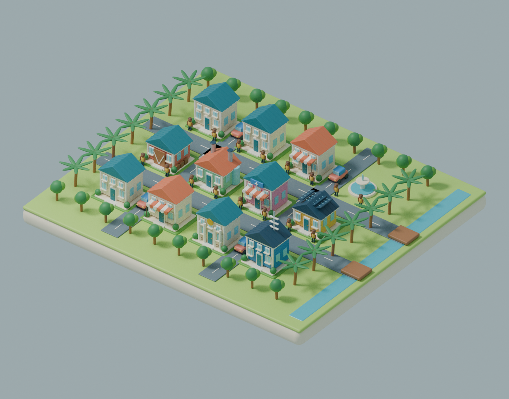
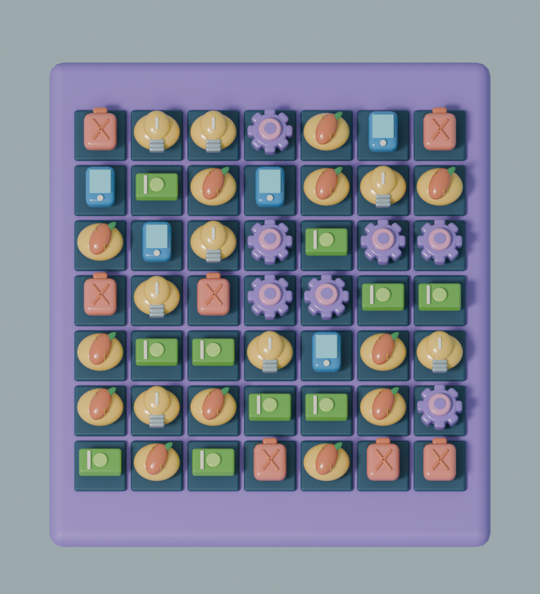

# PACO Unity — ville et puzzles en 3D

Première édition **Unity 6 LTS / C# / Universal Render Pipeline**, indépendante des versions Flutter et Kotlin. Le projet contient les modèles 3D originaux, les règles, les écrans et la préparation Android ARM64.

**État de livraison : projet source, pas un APK Unity validé.** L'éditeur Unity et sa licence ne sont pas disponibles dans l'environnement de travail. Les règles C# ont été exécutées et les modèles rendus dans Blender ; l'import Unity, le rendu URP, les tests Unity et la compilation Android doivent encore être exécutés avec l'éditeur. Les aperçus ci-dessous sont des rendus Blender des mêmes modèles FBX, sans interface de jeu superposée.

| Ville — modèles livrés | Puzzle — modèles livrés |
|---|---|
|  |  |

## Direction et contenu

- Une ville isométrique en vrais volumes : bâtiments aux arêtes arrondies, façades, fenêtres, auvents, toitures, végétation, canal, ponts, routes et passages piétons.
- Sept familles constructibles, maisons et fontaine ; habitants et véhicules avec itinéraires simples. Déplacement tactile, pincement pour zoomer et bouton de recentrage.
- **30 puzzles 7 × 7 et 30 quiz**, en cinq chapitres. Six pièces sectorielles aux silhouettes différentes et matériaux brillants, glissement ou deux taps, échanges annulés sans pénalité, cascades, gravité, particules, indices et mélange des plateaux bloqués.
- Consigne en fenêtre avant le départ, temps de 60 à 90 secondes, résultats avec véritables lettres 3D extrudées et arrondies « GAGNE » / « PAS DE CHANCE », animation de rebond et menu principal.
- Propriétés, cartes conservées après vente, Acheter plus en vert et Vendre en rouge ; frais, scénario de baisse et détachement du dividende fictif.
- Six quartiers supplémentaires financés par les gains ; construction après acquisition. Le centre-ville visible au départ est un décor communal, pas un portefeuille de biens déjà acquis.
- Voyage de **15 destinations et 45 quiz**, avec récompenses uniques. Le contenu sur le PER est corrigé pour éviter toute promesse de remboursement.
- Deux musiques et neuf bruitages repris du projet PACO ; réglages séparés, pause audio en arrière-plan, mouvements réduits et agrandissement des textes.
- Sauvegarde locale avec fichier de secours, lecture des formats PACO v1 à v4, import volontaire avec aperçu et confirmation, export JSON vers le presse-papiers. Les éditions possèdent chacune leur stockage Android ; aucune synchronisation automatique entre applications.

L'objectif artistique est un jeu mobile de gestion chaleureux et un Match-3 brillant, inspirés des qualités de composition et de lisibilité des références fournies. **Cette première base ne prétend pas égaler le volume de contenu, la finition ou les années de production de Township et Candy Crush.** Elle n'intègre pas encore une boucle agricole complète, les trains/avions, des centaines de bâtiments, des boosters spéciaux ni un service connecté.

## Ouvrir et jouer dans Unity

1. Installer **Unity Hub**, activer une licence Unity adaptée à son utilisation, puis installer **Unity 6000.0.62f1** avec Android Build Support, SDK/NDK et OpenJDK.
2. Ajouter ce dossier comme projet existant. Laisser Unity résoudre les packages et importer les FBX. URP 17.0.4 et uGUI 2.0.0 correspondent à la génération Unity 6000.0 ; Newtonsoft.Json 3.2.1 et Test Framework 1.4.6 sont déclarés.
3. La préparation initiale génère le pipeline, le matériau de shader conservé et `Assets/Paco/Scenes/Main.unity`. Si nécessaire, lancer **PACO > Préparer le projet**. Cette commande ne remplace pas une scène existante.
4. Ouvrir `Main.unity`, puis Play. Les objets et l'interface sont construits par `PacoApp` au chargement.
5. Lancer les tests EditMode et PlayMode dans Window > General > Test Runner. Le test PlayMode suppose un dossier de sauvegarde de test vierge ; ne pas utiliser une sauvegarde personnelle pour les essais.
6. Compiler par **PACO > Compiler Android ARM64**. Résultat attendu : `Builds/Android/paco-unity-0.1.0-arm64.apk`. Aucune clé de signature privée n'est incluse.

L'application Android utilise `ci.paco.bourse.unity`, distinct de Flutter et Kotlin. Le niveau minimal configuré est Android 7 / API 24 ; la cible dépend du SDK fourni avec l'éditeur. Le rendu emploie GLES3 et IL2CPP ARM64. Ces paramètres n'ont pas été vérifiés dans un APK compilé ici.

En ligne de commande, avec un éditeur déjà activé :

```sh
Unity -batchmode -projectPath "$PWD" -executeMethod Paco.Editor.ProjectSetup.Prepare -quit -logFile prepare.log
Unity -batchmode -projectPath "$PWD" -runTests -testPlatform EditMode -testResults edit-results.xml -logFile edit.log
Unity -batchmode -projectPath "$PWD" -runTests -testPlatform PlayMode -testResults play-results.xml -logFile play.log
Unity -batchmode -projectPath "$PWD" -buildTarget Android -executeMethod Paco.Editor.ProjectSetup.Android -quit -logFile android.log
```

Les tests PlayMode et le rendu peuvent nécessiter un affichage virtuel sous Linux ; éviter `-nographics` pour ces contrôles.

## Contrôles indépendants de Unity

Avec Python 3 et .NET SDK 8 :

```sh
python3 scripts/test_domain.py
python3 scripts/validate_assets.py
```

Treize scénarios ont été exécutés sur le véritable domaine C# : 30 étapes résolues pour cinq graines chacune, absence de pénalité sur les échanges invalides, trames de gravité, récompenses et frais, anciennes sauvegardes, terrains, dividende, délai, fichier de secours et 45 récompenses du Voyage.

Le contrôle optionnel de compilation de compatibilité utilise des DLL de référence externes Unity 2021/UGUI et Roslyn. Il ne lance pas Unity et ne vérifie pas les API de préparation de l'éditeur Unity 6. Voir [VALIDATION.md](docs/VALIDATION.md) pour les limites précises.

## Ressources et architecture

- `Assets/Paco/Domain/` : règles pures, catalogue, transactions, codec, sauvegarde et chronomètre.
- `Assets/Paco/Runtime/` : scènes, Canvas mobile, rendu des modèles, animation des tours, audio et navigation.
- `Assets/Paco/Editor/` : génération des réglages URP, scène et build Android, réglages d'import.
- `Assets/Paco/Resources/` : 21 modèles FBX originaux, catalogue, leçons, audio et police Nunito sous OFL.
- `Assets/Paco/Tests/` : quatre tests EditMode et un test PlayMode préparés, non exécutés ici.
- `scripts/build_art.py` : source Blender reproductible des modèles et des aperçus.

Pour recréer les modèles avec Blender 4.3 : `blender -b -t 2 --python scripts/build_art.py -- "$PWD"` après avoir créé `Builds/`. Le fichier Blender de travail généré est dans `Builds/`, exclu du dépôt ; les FBX et le script suffisent à régénérer la scène.

Un workflow manuel est fourni dans `.github/workflows/unity.yml`. Son activation dans GitHub Actions peut nécessiter l'intégration du workflow à la branche par défaut. Le build Unity exige les secrets de licence GameCI adaptés (`UNITY_LICENSE`, et selon la licence `UNITY_EMAIL` / `UNITY_PASSWORD`). Le workflow ne publie pas sur un store et n'a pas été exécuté dans cette livraison.

**Toutes les monnaies et entreprises sont fictives.** Voir [DESIGN.md](docs/DESIGN.md), [ARCHITECTURE.md](docs/ARCHITECTURE.md) et [VALIDATION.md](docs/VALIDATION.md).
