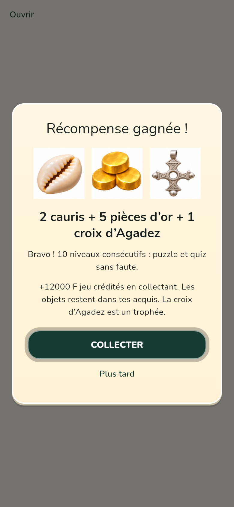
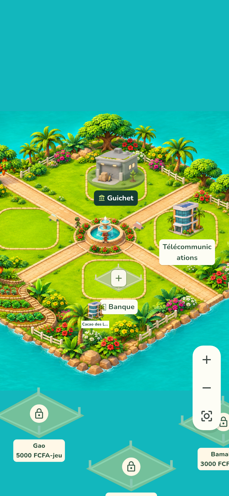
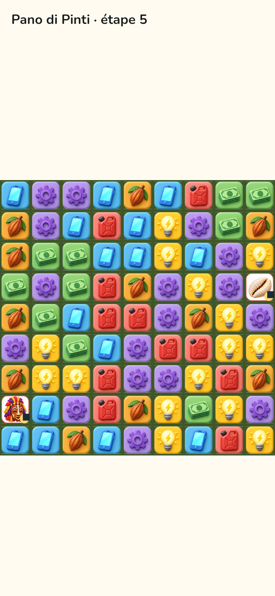

# PACO Flutter 0.9.0 — Héritages BRVM

[Télécharger l’APK Android ARM64](https://raw.githubusercontent.com/mrgohou/boursefacile-game/mobile/apk-v0.9.0-heritages/paco-flutter-0.9.0-heritages-brvm-arm64.apk) — 52,9 Mo, Android 7 minimum.

Installer par-dessus la version Flutter précédente **sans désinstaller** pour conserver les acquis. Même identifiant et même signature de développement que la version 0.8.0. APK AOT/profile destiné aux essais, sans publication Play Store.

- 20 pions culturels et cinq pouvoirs, légende et noms accessibles.
- Cinq familles de motifs de pagnes et 24 nouveaux bâtiments en argile.
- 32 villes des huit pays de la BRVM, 31 terrains achetables et 16 sites par ville ; développement rural, ville en essor puis moderne selon les gains, le score PACO et les investissements. Stade débloqué conservé après vente.
- Séries de 5 et 10 quiz/niveaux sans faute : colas, cauris, pièces d’or et trophée croix d’Agadez. Fenêtre animée **COLLECTER**, versement unique et trésors conservés. 1 cola = 500 F jeu ; 1 cauri = 1 000 F jeu ; 1 pièce d’or = 2 000 F jeu. La croix n’a pas de valeur monétaire.
- Migration v7 depuis les anciennes sauvegardes, portefeuille conservé, sans cadeaux rétroactifs.

**Validation : 89 tests Flutter et 4 tests d’interface/capture réussis ; analyse sans problème.** Atlas embarqués et signature APK vérifiés. Aucun téléphone physique utilisé.

[Sources](https://github.com/mrgohou/boursefacile-game/tree/50ecec4d67e502a228d72d8605c6aff0dd50daa2) · [Règles détaillées](https://github.com/mrgohou/boursefacile-game/blob/50ecec4d67e502a228d72d8605c6aff0dd50daa2/docs/RELEASE-0.9.md) · [Outils et skills utilisés](https://github.com/mrgohou/boursefacile-game/blob/50ecec4d67e502a228d72d8605c6aff0dd50daa2/docs/TOOLS-0.9.md) · [Contrôle SHA-256](SHA256SUMS)

Les captures ci-dessous proviennent de Flutter Test, pas d’un appareil Android. Les représentations culturelles sont des évocations artistiques originales. Le jeu reste une simulation pédagogique locale, sans investissement réel.

